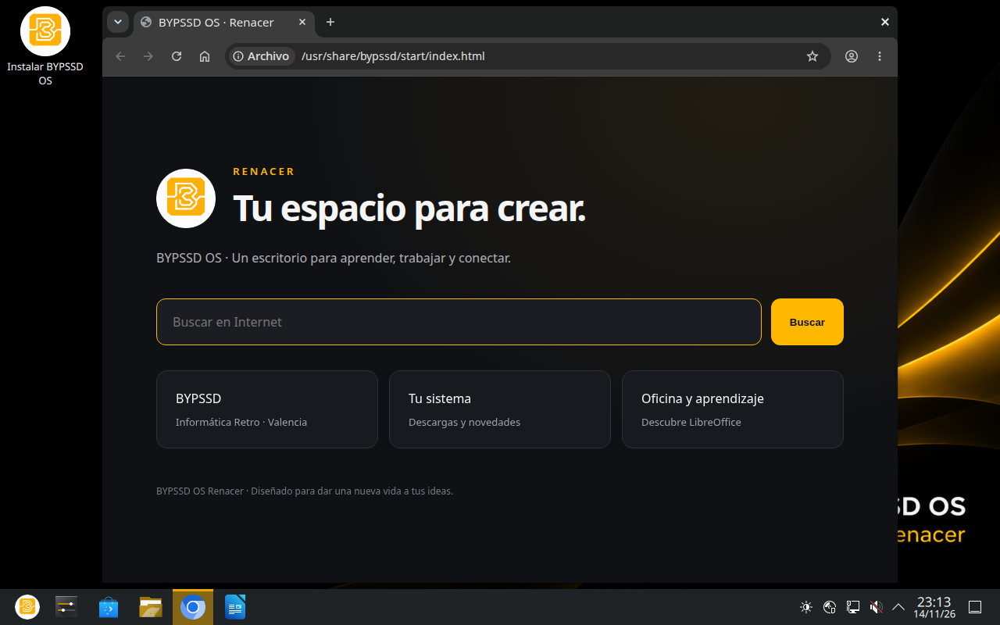
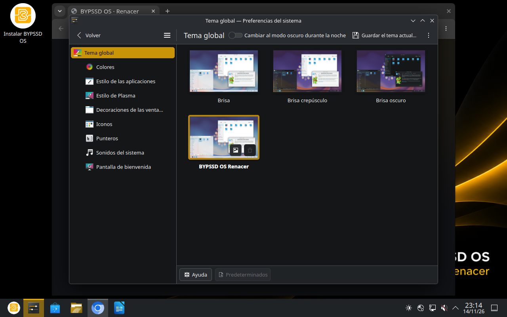
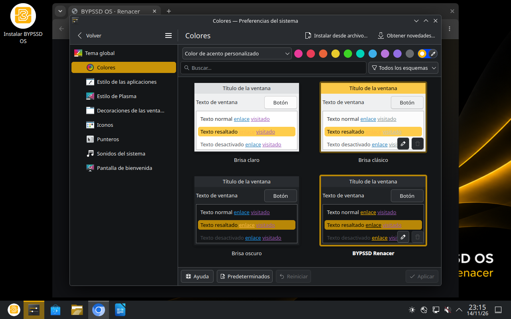
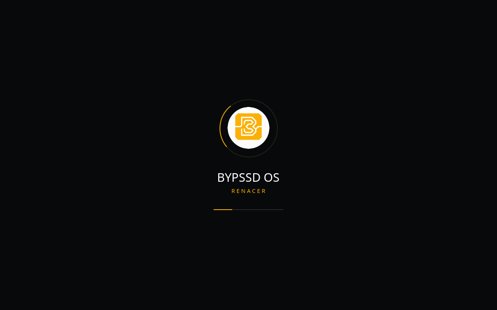

# BYPSSD OS Renacer 1.0 · revisión 8

Distribución para oficina y educación de BYPSSD Informática Retro (Valencia),
con KDE Plasma 6.8.2 y base Fedora Linux 45. Identificador del sistema: `bypssd`.

- **ARM64/aarch64:** ISO final publicada y checksum verificado.
- **x64/x86_64:** ISO publicada, compilada en runner nativo y arranque UEFI comprobado.
- Español de España, teclado español, Europe/Madrid.
- Amarillo #FFB800, negro #000000 y blanco #FFFFFF; escritorio oscuro inicial.
- Sesión en vivo con instalación mediante Anaconda y cuenta definida por el usuario.
- No se ha accedido ni modificado Parallels ni instalado Linux en el disco del Mac.

## Descargas

Las dos arquitecturas comparten esta release:
https://github.com/bypssd/bypssd-os/releases/tag/renacer-1.0-r8

Archivos locales de entrega:
- `out/BYPSSD-OS-Renacer-1.0-aarch64.iso` y `.iso.sha256`.
- `out/BYPSSD-OS-Renacer-1.0-x86_64.iso` y `.iso.sha256`.
- `out/package-manifest-ARQUITECTURA.txt` y `out/branding-audit-ARQUITECTURA.json`.
- `out/build-manifest-ARQUITECTURA.json`, procedencia y hashes locales.

Verificar desde out/ con `shasum -a 256 -c NOMBRE.iso.sha256`.
Las releases son candidatas de desarrollo; los RPM propios no tienen firma de producción.

La revisión 8 conserva ARM64 sin cambios respecto a r7 y corrige el menú GRUB de x64.
El kernel, initrd, ejecutables EFI y LiveOS de x64 conservan sus hashes originales.
El paquete visual sigue en 1.0-7. Se ha comprobado el arranque en QEMU; no se ha
validado todavía en todos los equipos físicos ni con Secure Boot.

## Qué incluye

LibreOffice Writer, Calc, Impress, Draw y Math; Chromium; Okular; Dolphin,
Konsole, Ark, Spectacle, Gwenview, impresión, ajustes y monitor del sistema.

Aplicaciones añadidas: Kate, KCalc, KDE Connect, Elisa, Haruna, Filelight, Skanpage,
KDE Partition Manager, KFind, KRDC, GIMP, Inkscape y diccionario español Hunspell.
No se incluyen grupos de juegos. Firefox se conserva por el instalador web.

Los RPM y sus fuentes propias están en Releases, en colecciones separadas para
ARM64 y x64. Los paquetes oficiales se conservan intactos y con sus firmas.
Las dependencias y actualizaciones siguen disponibles desde los servidores de
la base; no hace falta un espejo completo en el VPS de BYPSSD.

## Branding aplicado

| Superficie | Implementación |
|---|---|
| Identidad | `bypssd-release-identity`, os-release BYPSSD y releasever 45 para DNF |
| Escritorio | Tema global `com.bypssd.desktop`, colores Renacer, logo y fondo propios |
| Estilo Qt | Plugin BYPSSD derivado del estilo Breeze, sin reemplazar el binario oficial |
| Temas y fondos | Sustitución de plasma-lookandfeel-fedora y proveedores de fondos F45 mediante capacidades RPM propias |
| Navegadores | Página inicial BYPSSD local en Chromium, Firefox y Konqueror; favoritos propios |
| Chromium | Etiqueta de distribución BYPSSD mediante la configuración admitida por su wrapper |
| Login | Tema SDDM BYPSSD con controles oscuros y acento amarillo |
| Arranque | Plymouth propio, aro animado, entrada suave y barra de progreso |
| Entrada a sesión | KSplash con el mismo lenguaje visual que Plymouth |
| Instalación | Anaconda con nombre, logo, colores y lanzador BYPSSD; branding GTK y Cockpit |
| Acerca del sistema | Nombre, versión, web y logo BYPSSD |
| Actualizaciones | Nombres visibles BYPSSD para los repositorios, manteniendo claves y firmas originales |

La estética mantiene los componentes y los temas originales de KDE. Se han
retirado los temas Fedora de las galerías; no se atribuye a BYPSSD la autoría de KDE.
Los logos originales de Andy y sus variantes a 48 y 256 píxeles están en assets/.
El fondo se generó con image_gen; el prompt y las condiciones del arte se conservan.

La auditoría e inventario, capturas y límites están en
[docs/VALIDACION-R7.md](docs/VALIDACION-R7.md). La eliminación literal de Fedora
de todos los binarios, claves, nombres de paquetes, ABI, créditos y documentación
**no se ha realizado**: esas referencias de compatibilidad y procedencia se conservan.
La ruta UEFI técnica EFI/fedora permanece por compatibilidad con los cargadores firmados.
No se editan los archivos de fedora-release-common ni binarios de paquetes oficiales.

## Reproducir desde el Mac

Requisitos: Homebrew, git, Python 3, Podman, vfkit y QEMU. La máquina dedicada
`bypssd-build` es applehv rootful, 6 CPU, 8192 MiB y 60 GiB, separada de Parallels.
Solo se comparte ~/BYPSSD-OS. El contenedor privilegiado es bypssd-build-f45.

```sh
./build.sh all       # ARM64: entorno, RPM y composición
./build.sh env       # preparar solo el entorno
./build.sh rpms      # generar RPM y SRPM
./build.sh iso       # componer desde el entorno ya preparado
```

Los temporales y la raíz viven en un volumen ext4 Linux de 24 GiB en la VM;
no se construyen sobre el sistema de archivos compartido de macOS. El script
pone temporalmente SELinux del constructor en permisivo cuando hace falta y
restaura su estado al terminar. La imagen conserva SELinux Enforcing.

Los fuentes se fijan a etiquetas estables v6.8.2 de invent.kde.org:
- breeze: c97883a8fe41bce774835c25d7f7e321c71fa618.
- plasma-workspace: 30beb0095873364c6b34ebcfd292ecafd4db7f61.

Solo se compila el objetivo Breeze/Qt6 del plugin propio. El resto de KDE usa
paquetes oficiales. La bienvenida QML adaptada inicialmente fue sustituida en
r5 por una implementación propia; sus fuentes y licencias están en branding/.

## Reproducir x64, o ambas arquitecturas, en GitHub

El workflow `.github/workflows/build-iso.yml` usa runners nativos: Ubuntu x64
o ARM64, y un contenedor Fedora 45 privilegiado aislado. No ejecuta código en el
Mac ni toca Parallels. Necesita un repositorio público con Actions habilitado y
permiso contents:write para publicar sus propias releases.

Antes de publicar una nueva compilación, cambia las etiquetas de release del workflow
para no colisionar con los artefactos ya publicados.

```sh
gh workflow run build-iso.yml --repo bypssd/bypssd-os -f architecture=x86_64
gh workflow run build-iso.yml --repo bypssd/bypssd-os -f architecture=aarch64
```

Las etapas son RPM/fuentes, publicación de RPM, ISO/auditoría, publicación de ISO
con SHA256 y aplicaciones comunes. Los logs quedan como artefactos durante 14 días.
El estilo de versión idéntica puede reutilizarse de una release propia anterior;
si no está disponible se recompila desde su etiqueta fijada. No se reutiliza un
plugin de otra arquitectura.

La reproducción es funcional, no bit a bit: las fuentes están fijadas pero los
repositorios de actualizaciones pueden variar. Para congelar una edición hay
que conservar todos los RPM, sus fuentes y los manifiestos. La dependencia de
branding coincide con Plasma 6.8.2-1.fc45; futuras versiones deben probarse y
requieren actualizar esa capacidad de compatibilidad.

## Kickstart y KIWI

kickstart/bypssd.ks deriva del último árbol oficial anterior a la retirada de
fedora-kickstarts, commit d93b2accc04f9dfae72d9d6272a66cfb69df0d00.
Los templates KIWI se fijan a 4aec82eba1e440cefd40bb1ea79ebcbe3bd3b71c.
`scripts/prepare-kiwi.py` genera una descripción por arquitectura y adapta
cargadores, repositorios y plantillas. Las ISO usan EROFS, volumen BYPSSD y
metadatos BYPSSD. La composición usa KIWI porque livemedia-creator no completó
sus intentos en el entorno original; se conservan todos sus logs.

No usar el kickstart para instalar directamente un equipo: su particionado
corresponde al disco de imagen del proceso de construcción. El usuario final
instala desde la sesión live con Anaconda.

## GitHub sin VPS

[Guía de Releases y Pages](docs/REPOSITORIO-GITHUB.md). Los binarios van a Releases
y los metadatos DNF pueden ir a Pages. Una colección de RPM en Releases no es
por sí sola un repositorio DNF habilitado. No se publica ni instala una clave
privada; hace falta configurar una clave de publicación para habilitarlo con firmas.

## Publicación, licencias y validación

Se revisaron las políticas oficiales de Fedora y KDE el 14/11/2026; copias y
licencias de referencia en branding/policies/. No se presenta BYPSSD como edición
oficial ni producto avalado por Fedora, Red Hat o KDE e.V.

Se conservan avisos y licencias GPL/LGPL de los componentes derivados. Las recetas
originales tienen licencia MIT; esa licencia no se extiende a los logos o a todo
el software distribuido. Los SRPM propios acompañan las releases de paquetes.
Las fuentes de los paquetes oficiales están disponibles en sus repositorios;
antes de una publicación estable debe cerrarse la oferta/disponibilidad completa
de código correspondiente, firmas y política de mantenimiento.

Las pruebas son de máquinas virtuales aisladas. No se garantiza cualquier placa
ARM, Raspberry Pi, instalación nativa en Apple Silicon ni Secure Boot en hardware
real. La instalación completa en disco se validó con una candidata previa del
mismo instalador/base; los resultados exactos por revisión están documentados.

## Parar el entorno

```sh
podman --connection bypssd-build-root stop bypssd-build-f45
CONTAINERS_MACHINE_PROVIDER=applehv podman machine stop bypssd-build
launchctl bootout gui/$(id -u)/com.bypssd.builder
```

No usar podman machine reset, que puede afectar a máquinas ajenas al proyecto.
Los primeros constructores fallidos y los registros se conservan para diagnóstico.
El historial detallado de las primeras fases está en
[docs/HISTORIAL-R1-R4.md](docs/HISTORIAL-R1-R4.md).

## Capturas de la imagen final








